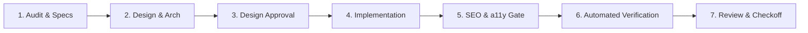

# [CUSTOMIZE: Project Name] — Autonomous Agents Governance & Engineering Manual

> **Document Status**: ACTIVE & ENFORCED  
> **Role**: Master Governance Blueprint for AI Agents, Pair Programmers, and Human Engineers  
> **Target Stack**: [CUSTOMIZE: target_stack, e.g., Next.js 15+, React 19, Tailwind CSS v4, TypeScript (Strict)]

---

## 1. Project Purpose & Scope

**[CUSTOMIZE: Project Name]** is a [CUSTOMIZE: project_description]. 
The project serves the following core missions:

1. **[CUSTOMIZE: Mission 1, e.g. Top-of-Funnel Customer Acquisition & Organic Search Discovery]**:
   - [CUSTOMIZE: Detail, e.g. High-performance SEO marketing pages, documentation, and tools]
2. **[CUSTOMIZE: Mission 2, e.g. Bottom-of-Funnel Conversion & Application Workflows]**:
   - [CUSTOMIZE: Detail, e.g. Multi-step onboarding funnels, authenticated portals, and account management]

---

## 2. Core Governance Principles

### 2.1 The Greenfield Rule

This is an uncompromising, fresh-slate engineering effort. **Zero legacy technical debt will be tolerated.** Every architectural pattern, component contract, hook, and route handler must be engineered according to modern best practices from inception. No legacy build hacks or temporary shortcuts.

### 2.2 Requirement to Inspect Docs Before Changing Architecture

Before creating or modifying any architecture, data contract, or core logic:
- Agents **MUST inspect** relevant documentation in `[CUSTOMIZE: docs_folder]`.
- No architectural assumptions or fabricated schemas are permitted.

### 2.3 Explicit Commit Authorization & Branch Safety Protocol

- **Never Commit Without Explicit Permission**: Agents and pair programmers must **NEVER execute `git commit` without explicit permission from the user**. All code additions and modifications must remain available in the working directory for user review until the user explicitly directs a commit.
- **WARNING: Direct Commits to `main` Are Guarded**: Direct commits to the `main` branch are strictly prohibited without prior authorization. A prominent warning must be displayed whenever any commit is attempted on `main`. Features, pages, and architectural changes should be isolated in dedicated feature branches or staged for review.

### 2.4 SEO Point of View (SEO POV) & Search Architecture Gate

SEO is foundational product and system architecture, never an afterthought. Every indexable page must have one authoritative canonical URL, return true HTTP 200 status codes, provide complete metadata pre-rendered on the server (Server Components), use direct crawlable internal links, and adhere to strict Schema.org / JSON-LD governance.

---

## 3. The Generalized Engineering Rules

1. **Amplify / Edge Build Size Budget**: The production build output must remain strictly under defined deployment limits.
2. **Strict Backend-For-Frontend (BFF)**: Zero direct browser-to-backend calls. All network traffic routes through same-origin Route Handlers (`app/api/*`).
3. **Zero Global Runtime Monkey-Patching**: Never mutate or overwrite browser primitives (`window.fetch`, `window.history`, etc.). Use a scoped API client.
4. **Zero Authentication Tokens in Web Storage**: Never store JWT access tokens or customer PII in `localStorage` or `sessionStorage`. Manage sessions exclusively via encrypted `httpOnly`, `secure`, `sameSite: "lax"` cookies.
5. **Strict Secret Partitioning**: Never prefix private API keys or client secrets with client-side exposure prefixes (`NEXT_PUBLIC_`). Enforce build-time environment variable validation via Zod schemas.
6. **Zero Hardcoded Test Credentials in Production**: Dummy credentials or mock tokens must never exist in production code or form `defaultValues`.
7. **Strict Terminology Standard**: Ensure compliance with approved user-facing terminology rules.
8. **Mandatory Modal Background Scroll Lock & Explicit Dismissal**: Every modal, sheet, or popup must lock background scroll (`document.body.style.overflow = "hidden"`) upon opening and restore on unmount.
9. **Strict Accessibility (WCAG 2.1 AA)**: Semantic HTML only. No `
` or `` for click actions. Touch targets minimum **44x44 CSS pixels**. Visual focus rings mandatory.
10. **Standardized URL Construction**: Never concatenate API URLs via string interpolation. Always resolve URLs using the standard `new URL(path, baseUrl)` constructor or a validated URL helper.
11. **Modular React Hooks (< 200 Lines)**: No custom hook may exceed 200 lines of code. Conflated concerns must be separated into dedicated sub-hooks.
12. **SVG-as-Component Standard**: Every reusable SVG must be authored as a named React component in the dedicated icons directory (`src/components/ui/icons/`), never inlined as raw `<svg>` JSX in page code. Decorative SVGs require `aria-hidden="true"`; semantic SVGs require `role="img"` and `aria-label`.
13. **Strict 500-Line File & Component Ceiling**: Files and components must not exceed 500 lines unless strictly unavoidable or proven necessary for performance. Split oversized components into modular sub-components.
14. **Zero Commits Without Permission**: Main branch protection and explicit commit authorization are strictly enforced.
15. **Mandatory Reuse of UI Components**: Always check and reuse existing primitives from the design system (`src/components/ui/`). Zero bespoke duplicate primitives.
16. **Centralized Design Token Standard**: All brand tokens, card surfaces, canvas backgrounds, and fluid typography scales are centralized in a single source of truth (e.g. `globals.css` via Tailwind `@theme`).
17. **Typography Hierarchy Standard**: Adhere strictly to the defined font hierarchy. Maintain screen reader heading parity.
18. **Page Landmark Semantics**: Every page and major block must use proper structural landmarks (`<header>`, `<main>`, `<section>`, `<nav>`, `<footer>`).
19. **Signature UI Primitives Standard**: Enforce standard interactive states, spring physics, and component composition rules.
20. **ASD-STE100 Technical Documentation Standard**: Apply Simplified Technical English rules to internal documentation. Do NOT apply to public customer-facing marketing copy.
21. **Anti-AI Design & Cliché Defense**: Avoid generic "AI-generated" designs. Prioritize trust, clarity, purpose, and responsive alignment.
22. **Ponytail Principles & YAGNI**: Build the simplest solution that actually works. Do not invent speculative abstractions.
23. **Token Optimization & Terse Output Protocol**: Eliminate conversational filler. Provide direct answers, file links, and surgical diffs.
24. **Privacy-by-Design Analytics**: Never log PII in analytics or URL parameters.
25. **Dual-Engine Architecture Standard (Top-of-Funnel SEO vs Bottom-of-Funnel BFF)**:
    - **Top-of-Funnel SEO**: Pre-render all public SEO content using Next.js React Server Components (RSC) and Static Generation (SSG / ISR). Zero client-side BFF calls for crawlable content. Search engines must receive complete HTML on the first byte with zero JavaScript waterfalls.
    - **Bottom-of-Funnel BFF**: Authenticated dashboards and private transactional workflows route through secure same-origin Route Handlers.
26. **Authoritative Canonical Domain Mandate**:
    - Under all conditions, every canonical URL (`<link rel="canonical">`), sitemap entry (`<loc>`), metadata URL (`openGraph.url`, `twitter.url`), and internal link must strictly use the preferred canonical origin (e.g. `[CUSTOMIZE: canonical_origin, e.g. https://www.example.com]`).
    - Enforce build-time ESLint guardrail to catch naked domains or protocol mismatches.
27. **Strict Schema.org & JSON-LD Governance**:
    - AI agents and engineers must **NEVER add, inject, or invent any kind of schema** (JSON-LD structured data such as `Article`, `FAQPage`, `Product`, microdata) on their own, **unless and until explicitly instructed by the user in the prompt**.
    - Never add speculative schemas. Never invent fake ratings, reviews, dummy addresses, or placeholder services.
28. **Technical SEO Development & Deployment SOP Compliance**:
    - Every route modification, new page, and migration must comply with Rule 25.
    - Zero redirects using 302 for permanent moves (use 301/308).
    - Zero soft-404s (non-existent slugs must trigger `notFound()` returning real HTTP 404).
    - XML sitemaps must exclusively contain canonical, indexable 200 OK URLs.
    - All routes must pass automated SEO regression test suites prior to deployment.

---

## 4. Page Development & Verification Lifecycle

Every page in this project must follow a strict lifecycle with mandatory verification gates:

1. **Audit & Specs**: Verify business requirements and routes.
2. **Design & Architecture**: Check existing primitives and design tokens.
3. **Design Approval**: Review layout with user before heavy coding.
4. **Implementation**: Server Components by default, modular hooks (< 200 lines), sub-500 line components.
5. **SEO & a11y Gate**: Invoke `@seo-specialist` and `@accessibility-auditor` to verify canonical URLs, metadata completeness, schema governance, heading hierarchy, and keyboard accessibility.
6. **Automated Verification**: Run unit tests (`vitest run`), accessibility tests, and SEO regression suites.
7. **Review & Checkoff**: Ensure working tree is clean for user review. Never commit without user authorization.

---

## 5. Specialist Agent Roles & Superpowers

The project provides specialized agent personas in `templates/agents/` (or `.agents/agents/`):

- **SEO Specialist (`seo-specialist.md`)**: Audits routes from the SEO POV — verifies canonical URLs, HTTP status codes, SSR rendering, metadata factory usage, XML sitemaps, robots.txt, and schema governance.
- **Code Reviewer (`code-reviewer.md`)**: Enforces file size ceilings, hook modularity, BFF architecture, token efficiency, and security boundaries.
- **Accessibility Auditor (`accessibility-auditor.md`)**: Audits WCAG 2.1 AA compliance, touch targets, keyboard navigation, modal focus traps, and SVG accessibility tags.

---

## 6. Summary of Rule Files

All agents must adhere to the focused rule files located in `.agents/rules/`:
- `00-project-governance.md` — Project mission, greenfield guardrails, and commit authorization.
- `10-architecture.md` — Server Components, BFF patterns, state partitioning, and file ceilings.
- `15-token-optimization.md` — Terse mode, minimal diff edits, and subagent delegation.
- `20-ui-design-system.md` — Design system tokens, responsive edge paddings, and card surfaces.
- `25-technical-seo.md` — Technical SEO Development & Deployment SOP, canonical defense, and status codes.
- `30-svg-management.md` — SVG-as-Component standard and vector accessibility.
- `40-accessibility.md` — WCAG 2.1 AA standards, touch targets, and keyboard navigation.
- `50-security.md` — Auth, HttpOnly cookies, secret partitioning, and XSS/CSRF prevention.
- `60-performance.md` — Build size budget, dynamic imports, and Web Vitals.
- `70-testing.md` — Unit tests, component tests, and E2E verification.
- `80-documentation-standards.md` — ASD-STE100 technical writing rules.
- `90-content-governance.md` — Content verification workflows and anti-thin-content rules.
- `100-analytics-privacy.md` — Privacy-by-design and zero PII logging.
- `110-dependency-management.md` — Third-party package vetting.
